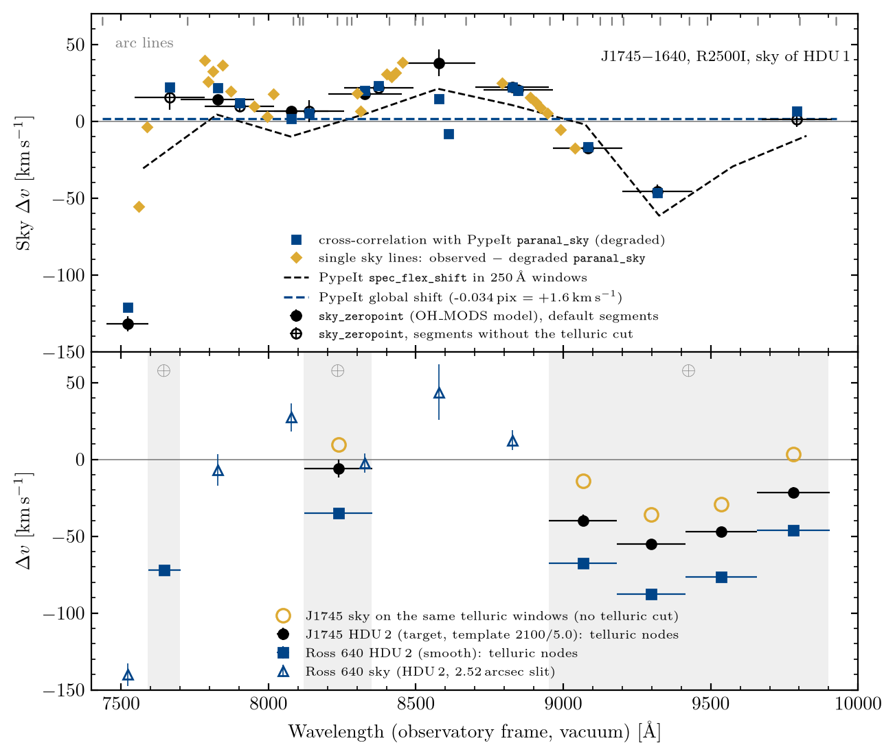

# Calibration audit: the absolute wavelength zero point of the GTC/OSIRIS spectra

Here, we summarise the audit of the wavelength zero point of the GTC/OSIRIS R2500I spectra (night of 2015 August 3, OB0055: J1745−1640 and Ross 640), which set the zero-point error budget of rvfitter.
All values are in the observatory frame (vacuum).
A positive Δv means that the observed wavelengths are too red.
The audit was an analysis only: no choice was tuned to the J1745−1640 benchmark (26.2 ± 2.3 km/s).

Figure: Top, the zero point Δv of the sky of J1745−1640 (spec1d HDU 1) against wavelength.
Blue squares show the cross-correlation with `PypeIt`'s `paranal_sky` (degraded to the observed resolution), gold diamonds single sky lines (observed minus degraded `paranal_sky`), the black dashed line `PypeIt`'s own `spec_flex_shift` in 250 Å windows, and the blue dashed line its single global shift (−0.034 pixel = +1.6 km/s).
Black filled circles show `sky_zeropoint` with its default segments, and open circles the segments without the telluric cut.
Grey ticks along the top mark the arc lines.
Bottom, the stars' own zero points from the telluric bands (grey, ⊕): J1745−1640 (HDU 2, template 2100/5.0; black circles) and Ross 640 (HDU 2, smooth model; blue squares), with the J1745−1640 sky measured in the same windows (open gold circles) and the Ross 640 sky (open blue triangles; 2.52 arcsec slit).

## 1. The wavelength solution is distorted

The arc solution has an RMS of only 0.1 Å, but this measures internal consistency, not the zero point.
Four independent measurements of the sky of J1745−1640 agree (Table 1 and the Figure):
(a) `sky_zeropoint` (cross-correlation with the `PypeIt` OH_MODS model);
(b) cross-correlation with `PypeIt`'s Paranal sky spectrum;
(c) Gaussian centroids of 23 vetted single sky lines;
(d) `PypeIt`'s own `spec_flex_shift`, run in 250 Å windows.
The sky is +5 to +38 km/s too red over 7700–8950 Å, where every alkali line lies, and −17 to −46 km/s too blue over 9000–9450 Å.
This is a distortion of the solution, not a flexure shift.

Table 1: Sky zero point of J1745−1640 (spec1d HDU 1) per segment [km/s].
"Default" are `sky_zeropoint`'s segments (telluric bands of depth ≥ 0.3 cut out), "no cut" the segments without that cut, "Paranal" the cross-correlation of the same segments with `PypeIt`'s Paranal sky, and "synthetic" the value `sky_zeropoint` measures on the degraded Paranal sky placed on the same pixels (truth 0).

| Segment [Å] | Default | Paranal | Synthetic (truth 0) |
|---|---|---|---|
| 7451–7592 | −131.6 ± 4.9 | −121.3 | −14.8 |
| 7702–7952 | +14.0 ± 3.4 | +22.0 | −9.7 |
| 7952–8202 | +6.8 ± 2.0 | +1.5 | +4.2 |
| 8202–8452 | +17.5 ± 1.7 | +19.8 | −3.2 |
| 8452–8702 | +37.9 ± 8.7 | +14.7 | — |
| 8702–8952 | +22.3 ± 1.5 | +22.3 | −0.3 |

| Segment, no cut [Å] | No cut | Paranal |
|---|---|---|
| 8965–9201 | −17.7 ± 2.4 | −16.8 |
| 9201–9437 | −45.7 ± 4.4 | −46.5 |
| 9674–9910 | +1.4 ± 5.3 | +6.5 |

The synthetic test shows that `sky_zeropoint` is unbiased (−1.5 ± 5.9 km/s overall) except in the short blue-edge segment, 7451–7592 Å, bounded by the O2 A band, where the bias is −8 to −22 km/s for sky-line widths of 0.8 to 1.25 times the observed one.
The −132 km/s there is nevertheless real to within that bias, because the Paranal cross-correlation gives −121 km/s.

### Why `PypeIt` found ≈0 flexure

`PypeIt` measured one global shift by cross-correlating the whole sky with its archived sky spectrum: −0.022 pixel in the header (−0.034 pixel when we re-ran it, +1.6 km/s).
Run in 250 Å windows, the same routine gives −30, +4, −10, +5, +21, +11, −2, −61, −29 and −9 km/s from 7450 to 9950 Å.
The single global value is therefore the average of a distortion of both signs, which cancels.
Injected shifts of ±20 and ±40 km/s were recovered by the routine, so the ≈0 is not a failure to detect.

## 2. Each star sees the sky's shape plus its own constant

The telluric absorption shares the star's light path, so the telluric bands measure the star's own zero point.
The star's zero point equals the sky's at the same wavelengths plus a constant, which is set by where the star sits in the slit.
This was not visible when the sky curve was interpolated across its gaps, but it is clear when the sky is measured directly in the same windows as the telluric nodes, including inside the H2O bands (Table 2).

Table 2: Star minus sky per telluric node [km/s] (the sky of J1745−1640 HDU 1 measured directly in each node's window; nodes whose sky correlates below 0.7 are not used).
J1745−1640 is fitted with the BT-Settl 2100/5.0 template, Ross 640 with a smooth star.
O2 A is not used for J1745−1640 (below 2800 K the K I wings fill it).

| Node [Å] | Sky | J1745−1640 star | J1745−1640 star − sky | Ross 640 star | Ross 640 star − sky |
|---|---|---|---|---|---|
| H2O 8122–8352 | +9.8 ± 3.6 | −6.0 ± 5.6 | −15.8 ± 6.7 | −35.1 ± 1.3 | −44.9 ± 3.9 |
| H2O 8952–9181 | −14.2 ± 2.3 | −39.7 ± 3.8 | −25.5 ± 4.4 | −67.5 ± 1.2 | −53.2 ± 2.6 |
| H2O 9181–9416 | −35.8 ± 4.8 | −55.3 ± 2.3 | −19.5 ± 5.4 | −87.5 ± 0.8 | −51.7 ± 4.9 |
| H2O 9416–9656 | (corr. 0.56) | −47.0 ± 1.4 | — | −76.3 ± 1.0 | — |
| H2O 9656–9903 | +3.2 ± 5.6 | −21.5 ± 3.3 | −24.7 ± 6.5 | −46.1 ± 1.2 | −49.2 ± 5.8 |
| Constant (χ²/dof) | | | **−22.1 ± 2.8** (1.9/3) | | **−50.7 ± 2.0** (3.4/3) |

- Both stars are consistent with "the sky's shape plus a constant" (p = 0.60 and 0.34), whilst the tellurics alone span 49 and 52 km/s over the same nodes.
- With a smooth star instead of the template, J1745−1640 gives −18.6 km/s (χ² 0.6/3), so template mismatch does not drive the constant.
- The constant varies by over 100 km/s between objects in the same slit: the other trace of the J1745−1640 spec1d (SPAT0168) gives +59.2 km/s and that of Ross 640 +140.3 km/s.
  An offset of 1 arcsec across the slit is ${\approx}190$ km/s at R2500I with 2 × 2 binning, so these are off-centre point sources.
- We note that the Ross 640 comparison uses the sky of the J1745−1640 exposure (the same night and solution, but a 1.23 arcsec rather than a 2.52 arcsec slit), so its constant also contains any change of the solution between the two exposures.

## 3. The paper's RVs against the literature

The 12 objects of Cooper et al. (2024) with an independent literature RV give paper − literature differences from −43 to +45 km/s, against quoted errors of 2–7 km/s (Table 3).
Per-object absolute zero-point errors of ~20 km/s are therefore real for slit spectra without a telluric constraint.

Table 3: Paper RVs (Cooper et al. 2024) against the literature [km/s].

| Object | Night | Literature | Reference | Paper | Paper − literature |
|---|---|---|---|---|---|
| SDSS J0235−0849 | 2015-08-31 | 22.8 ± 6.1 | 2010AJ....139.1808S | 28.4 ± 28.0 | +5.6 |
| 2MASS J0940+2946 | 2016-02-26 | 4.1 ± 7.1 | 2010AJ....139.1808S | 49.4 ± 6.7 | +45.3 |
| 2MASS J1109−1606 | 2015-12-30 | 69.9 ± 10.0 | 2010AJ....139.1808S | 58.1 ± 1.2 | −11.8 |
| 2MASS J1127+4705 | 2015-12-30 | −26.4 ± 6.5 | 2010AJ....139.1808S | 9.4 ± 73.3 | +35.8 |
| 2MASS J1331+3407 | 2015-04-28 | 11.6 ± 60.4 | 2010AJ....139.1808S; 2010ApJS..190..100K | 11.5 ± 2.8 | −0.1 |
| 2MASS J1346+0842 | 2016-01-06 | −17.7 ± 10.6 | 2010AJ....139.1808S | −47.7 ± 6.2 | −30.0 |
| 2MASS J1532+2611 | 2016-01-29 | 9.2 ± 12.4 | 2010AJ....139.1808S | −12.5 ± 6.7 | −21.7 |
| 2MASS J1539−0520 | 2016-02-27 | 27.33 ± 0.24 | 2010ApJ...723..684B | 24.8 ± 2.6 | −2.6 |
| 2MASS J1623+1530 | 2015-09-02 | 5.4 ± 17.2 | 2010AJ....139.1808S | −38.0 ± 11.8 | −43.4 |
| 2MASS J1623+2908 | 2016-02-12 | −8.1 ± 11.5 | 2010AJ....139.1808S | −20.0 ± 5.9 | −11.9 |
| DENIS J1745−1640 | 2015-08-04 | 26.0 ± 2.0 | 2015ApJS..220...18B | 32.7 ± 6.5 | +6.7 |
| 2MASS J1750−0016 | 2015-04-02 | 19.0 ± 3.0 | 2015ApJS..220...18B | 11.7 ± 2.2 | −7.3 |

## Consequences for rvfitter

- An offset is either applied, with its error carried as a systematic, or unknown, with a physically motivated prior width; a measured offset's value is never added to the error budget.
- The default (`sky-if-needed`, and `auto`, which is now the same) applies the sky curve when the calibration data need it, and the star − sky constant with it when at least two telluric nodes have the sky measured in the same window (`wavelength_correction_applied = "sky+star"`; its error is `sys_star_sky`).
- Otherwise `sys_star_sky` is the slit-centring prior: the RMS centroid of a Gaussian profile clipped by the slit, for a position uniform within ±max((W − F)/2, 0.1 arcsec), through the plate scale and the dispersion (for J1745−1640, W = 1.23 arcsec from `DECKER`, F = 3.06 binned pixels × 0.254 arcsec = 0.78 arcsec, σ = 0.092 arcsec = 18.0 km/s).
- `sky_zeropoint` adds a synthetic bias test to every segment, which down-weights the blue-edge segment; `io` drops absurd sky pixels.
- The details are in `docs/methods.md` (Wavelength zero point) and `docs/dev_notes_methods.md`.

In conclusion, the GTC/OSIRIS R2500I solution is distorted by tens of km/s in a way that the arc RMS and `PypeIt`'s global flexure cannot see, and each star adds its own slit-centring constant of a few tens of km/s; both must be corrected, or carried in the error budget, for an absolute RV.
