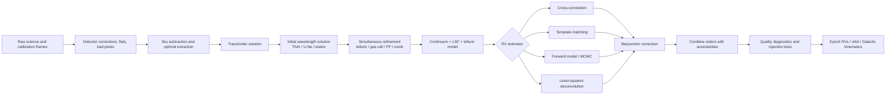

# Measuring Radial Velocities of Brown Dwarfs from Spectra

## Executive summary

Radial velocities (RVs) of brown dwarfs are measured from the Doppler displacement of photospheric absorption structure, but the practical problem differs substantially from classical optical stellar RV work. Brown dwarfs are intrinsically faint, emit most strongly in the near-infrared (NIR), rotate rapidly, and have spectra dominated by dense, blended molecular absorption plus strongly pressure-broadened alkali lines. Consequently, **RV information normally comes from fitting many pixels or many lines simultaneously rather than measuring individual line centers**. High spectral resolution improves the velocity information until intrinsic/rotational line widths dominate; thereafter photon collection, wavelength calibration, template fidelity, and telluric treatment become at least as important as resolution. High-resolution J-band spectra, for example, contain hundreds of FeH and H\(_2\)O features together with strong K I lines, while K-band spectra provide an especially useful forest of CO and H\(_2\)O lines. citeturn23search3turn19search6

For **late-M and L dwarfs**, useful information exists from the far-red optical through K band. Optical work can exploit K I, Na I, FeH and other atomic/molecular structure, but the rapidly declining optical flux increasingly penalizes L dwarfs. The Y/J bands provide K I, FeH and H\(_2\)O; H-band contains a dense molecular spectrum and is successfully exploited by APOGEE; K-band CO overtone and H\(_2\)O structure around 2.3 μm has historically delivered some of the best L-dwarf RVs. For **T dwarfs**, J and K windows remain useful but atmospheric-model fidelity, particularly CH\(_4\), becomes increasingly important. Hsu et al. obtained a median 0.5 km s\(^{-1}\) precision for 37 T dwarfs with NIRSPEC forward modeling. citeturn23search0turn22search0turn17search2

A representative progression in demonstrated brown-dwarf/UCD performance is: roughly **2–3 km s\(^{-1}\)** at \(R\sim4{,}100\) with MagE; **∼2 km s\(^{-1}\)** in early general-purpose NIRSPEC surveys at \(R\sim20{,}000\); **∼0.3 km s\(^{-1}\)** for L dwarfs at \(R\sim50{,}000\) with PHOENIX and telluric CH\(_4\); **∼0.2 km s\(^{-1}\)** for slowly rotating L dwarfs in the optimized NIRSPEC survey; and **0.4–0.5 km s\(^{-1}\)** median precision in recent large forward-modeling samples of M6–L2 and T dwarfs. These values are not a monotonic function of resolving power because spectral type, brightness, \(v\sin i\), spectral grasp, calibration, and analysis methodology differ. citeturn17search0turn17search1turn19search6turn17search2turn22search0turn23search0

The most successful modern methodology is generally **pixel-level forward modeling**: simultaneously fit the Doppler-shifted brown-dwarf spectrum, rotational broadening, instrumental line-spread function (LSF), continuum, wavelength solution, and—when observing from the ground—the telluric spectrum and any gas-cell absorption. Cross-correlation remains effective for reconnaissance and relative velocities, while empirical templates can outperform imperfect atmospheric line lists if a suitably matched reference exists. Synthetic templates, however, allow absolute velocities and simultaneous atmospheric/rotational inference. Hsu et al. found measurable RV offsets between different atmosphere-model families, illustrating that model mismatch is now a genuine component of the error budget. citeturn23search1turn3view0turn3view1

Calibration strategy depends strongly on bandpass. **ThAr** remains effective in the optical; **U-Ne/U-Ar and Fabry–Pérot etalons** are better suited to stabilized NIR instruments; **iodine cells** are excellent at 500–620 nm but poorly matched to ordinary L/T dwarfs because these objects provide little flux there; **NIR gas cells** provide common-path calibration but sacrifice throughput and cover limited wavelength intervals; **telluric lines** are free, simultaneous references and historically enabled 0.2–0.3 km s\(^{-1}\) L-dwarf work, but atmospheric variability ultimately limits them; and **laser frequency combs (LFCs)** offer the most regular and fundamentally stable calibration grid where available, although published brown-dwarf surveys have so far been dominated by lamps, etalons, tellurics, and gas cells rather than combs. Uranium-neon alone provides more than 10,000 characterized lines from 0.85–4 μm, illustrating why uranium lamps became attractive for NIR velocimetry. citeturn22search7turn21search0turn23search2turn19search6

For a new program, the critical design decision is therefore **not simply “obtain the highest \(R\)”**. It is to maximize Doppler information per unit observing time while controlling the zero point: select the spectral window appropriate to the target subtype, estimate the attainable S/N for the actual \(J/H/K\) magnitude, account for \(v\sin i\), choose a calibration architecture that follows instrumental drift, model rather than indiscriminately divide telluric absorption, and validate the complete pipeline with stable standards and injection/recovery tests. Modern cross-dispersed instruments such as CRIRES+, CARMENES, SPIRou and iSHELL offer substantially greater spectral grasp and/or stability than the single-order instruments used in early brown-dwarf work. citeturn20search4turn21search0turn21search2turn21search9

## Physical basis and useful spectral information

For non-relativistic brown-dwarf velocities,

\[
\frac{\Delta\lambda}{\lambda}\simeq\frac{v_r}{c},
\]

so the objective is to estimate a common displacement of photospheric spectral structure relative to laboratory, synthetic, or empirical rest wavelengths. A spectrograph with resolving power \(R=\lambda/\Delta\lambda\) has a nominal resolution element \(\Delta v\simeq c/R\): about 73, 15, 13, 6 and 3 km s\(^{-1}\) at \(R=4{,}100\), 20,000, 22,500, 50,000 and 100,000, respectively. **RV precision can nevertheless be much smaller than one resolution element** because thousands of spectral pixels jointly constrain the centroid. The useful information scales with S/N, number and depth of spectral features, and especially their wavelength gradients; rotational and pressure broadening flatten those gradients and therefore reduce velocity information. Calculations for very-low-mass stars likewise show that rapid rotation erodes the advantage of increasing spectral resolution once rotational widths dominate. citeturn0search10turn23search3

Brown dwarfs make that information problem unusually nonlinear. McLean et al.'s \(R\sim20{,}000\) NIRSPEC sequence from M2.5 through T6 identified more than 200 weak J-band features attributable to FeH or H\(_2\)O. FeH becomes strongest around the mid-L sequence while H\(_2\)O strengthens toward later types. The strong J-band K I lines have enormous pressure-broadened wings—growing from tens to hundreds of km s\(^{-1}\)—so the strongest-looking feature is not necessarily the feature carrying the most precise centroid information. citeturn23search3

| Regime | Principal RV information | Strengths | Main limitations |
|---|---|---|---|
| **Red optical, ∼0.65–1.0 μm** | K I 7665/7699 Å; Na I ∼8183/8195 Å; FeH and other molecular/atomic structure | Rich, relatively well-understood atomic spectrum for late-M/early-L; excellent optical calibration technology; UVES-class resolving power | Severe photon penalty toward mid/late-L and essentially prohibitive for ordinary T dwarfs; alkalis are strongly pressure broadened; activity/spot contrast is greatest in the optical. UVES brown-dwarf programs commonly worked around 0.67–1.0 μm. citeturn20search0turn16academia26turn15search3 |
| **Y/J, ∼0.95–1.33 μm** | K I doublets near 1.17 and 1.25 μm; FeH; dense H\(_2\)O; residual atomic Fe at earlier types | High brown-dwarf flux; many resolved molecular gradients; useful from late-M through T | Pressure-broadened K I is not an intrinsically narrow reference; FeH fades at late type; atmospheric models/line lists become important. NIRSPEC observations demonstrate this regime from M through T. citeturn23search3 |
| **H, ∼1.5–1.7 μm** | H\(_2\)O and FeH-rich molecular spectrum plus weaker atomic structure | Very favorable SED for many late-M/L dwarfs; large cross-dispersed spectral grasp; APOGEE demonstrates efficient survey-scale RV work | Significant telluric H\(_2\)O bands and detector/calibration complexities; feature mix changes rapidly with \(T_{\rm eff}\). APOGEE obtains \(R\simeq22{,}500\) spectra from 1.51–1.70 μm. citeturn20search3turn22search0 |
| **K, ∼2.0–2.4 μm** | CO overtone bands around 2.29–2.35 μm and H\(_2\)O; CH\(_4\) becomes important in cooler atmospheres | Exceptionally useful line forest for L dwarfs; telluric CH\(_4\) can simultaneously provide a wavelength fiducial; favorable contrast against spots | Strong telluric contamination; thermal background increases; CO weakens/chemistry changes in the coolest objects. Classic PHOENIX/NIRSPEC programs exploited this region. citeturn19search6turn17search2 |
| **3–5 μm / NIR–mid-IR boundary** | CO fundamental near 4.5 μm, CH\(_4\), H\(_2\)O | Strong fundamental molecular bands; favorable for very cool objects; space data avoid terrestrial tellurics | Ground-based thermal background and deep terrestrial molecular absorption; high-resolution precision-RV use remains much less mature. A 2026 JWST/NIRSpec study used the 4.5-μm CO fundamental for 23 metal-poor L/T/Y dwarfs. citeturn22search1 |
| **Strict mid-IR, \(\gtrsim5\,\mu{\rm m}\)** | H\(_2\)O, CH\(_4\), NH\(_3\), CO-related molecular structure depending on temperature | Potentially powerful atmospheric diagnostics for the coolest T/Y dwarfs | Routine high-precision brown-dwarf RV work is not yet established here; background, sensitivity, and lack of broadly available stabilized high-\(R\) velocimeters dominate. CRIRES+ and iSHELL terminate near 5.3 μm, illustrating the current practical high-resolution boundary. citeturn20search4turn21search9 |

A useful rule is therefore **late-M/early-L: red optical through H/K; mid/late-L: J/H/K; T: J and selected K regions; very cool or metal-poor L/T/Y: potentially the 4–5 μm CO fundamental**. This is not merely an SED argument: the optimal band is the product of source photons, line gradients, telluric transmission, rotation, detector performance, and model reliability. Hsu et al., for example, found useful NIRSPEC T-dwarf information around 1.299–1.329 μm and 2.269–2.341 μm, while their comparison of BT-Settl and Sonora templates showed subtype- and band-dependent RV differences attributable to atmospheric modeling. citeturn3view0turn3view1

## Instruments, spectral resolution, and wavelength calibration

The historical distinction between **single-order** and **cross-dispersed echelle** work matters. PHOENIX delivered very high resolution over a narrow ∼2.3-μm interval and enabled the first ∼300 m s\(^{-1}\) multiepoch L-dwarf measurements, but only a limited number of CO/H\(_2\)O lines were recorded at once. Cross-dispersed NIRSPEC records several echelle orders simultaneously, increasing the available Doppler information and enabling different orders to be selected according to spectral type and telluric transmission. Modern fiber-fed cross-dispersed spectrographs extend this advantage to nearly entire atmospheric bands while stabilizing illumination and instrument temperature. citeturn19search6turn21search5turn21search11

| Instrument | Telescope | Architecture | Approximate useful specification | Relevance to brown-dwarf RVs |
|---|---|---|---|---|
| **UVES** | ESO VLT UT2, 8.2 m | Slit-fed cross-dispersed optical echelle | 0.30–1.10 μm; \(R\sim40{,}000\) with 1″ slit, up to \(\sim110{,}000\) in red arm | Classic young-BD optical RV work; strong far-red molecular/alkali spectrum; conventional lamps/tellurics. Iodine cell available at 500–600 nm, although that band is poorly matched to L/T flux. citeturn20search0 |
| **MagE** | Magellan Baade, 6.5 m | Cross-dispersed optical echellette | 0.31–1.0 μm; \(R\sim4{,}100\) with common setup | Efficient kinematic RVs rather than high-precision planet work; Burgasser et al. reached 2–3 km s\(^{-1}\) for 85 late-M/L objects. citeturn17search0turn13search0 |
| **PHOENIX** | Gemini South, 8.1 m in the cited program | High-resolution, narrow-grasp/single-order IR spectroscopy | \(R\sim50{,}000\) around 2.3 μm in Blake et al. | Demonstrated 300 m s\(^{-1}\) on L dwarfs using telluric CH\(_4\) against CO/H\(_2\)O. citeturn19search6 |
| **NIRSPEC** | Keck II, 10 m | Slit-fed cross-dispersed IR echelle | 0.96–5.5 μm historically; brown-dwarf studies typically \(R\sim20{,}000\)–35,000 depending on epoch/setup | Workhorse for M/L/T RVs; supports J/K forward modeling and multiepoch binary studies. Upgraded in 2018. citeturn21search5turn21search51turn23search0 |
| **APOGEE** | Sloan 2.5 m and du Pont 2.5 m | Fiber-fed, multi-object cryogenic H-band spectrograph | 1.51–1.70 μm; \(R\simeq22{,}500\) | Massive homogeneous UCD sample; Hsu et al. modeled 258 M6–L2 objects at median 0.4 km s\(^{-1}\). citeturn20search3turn22search0 |
| **CARMENES** | Calar Alto 3.5 m | Stabilized fiber-fed dual cross-dispersed echelles | VIS 0.52–0.96 μm, \(R=94{,}600\); NIR 0.96–1.71 μm, \(R=80{,}400\) | Especially attractive for bright late-M/very nearby early-L objects because optical and NIR RVs are simultaneous; uses Th-Ne/U-Ne plus Fabry–Pérot calibration. citeturn21search0 |
| **SPIRou** | CFHT 3.6 m | Cryogenic fiber-fed cross-dispersed echelle/spectropolarimeter | 0.967–2.493 μm; effective \(R\sim65{,}000\)–70,000; simultaneous FP reference | Large YJHK grasp and highly stabilized RV architecture; current performance on quiet M-star standards is ∼2 m s\(^{-1}\), although faint/rapidly rotating brown dwarfs are photon/line-width limited well above that floor. citeturn21search2 |
| **CRIRES+** | ESO VLT UT3, 8.2 m | AO-fed slit cross-dispersed cryogenic echelle | 0.95–5.3 μm; \(R\ge43{,}000\) with 0.4″ slit, roughly 86,000–92,000 with 0.2″ | Particularly powerful for targeted J/K/L/M spectroscopy and 2.3-μm CO; calibration unit includes lamps, gas cells, Fabry–Pérot and hollow-cathode sources. citeturn20search4 |
| **iSHELL** | NASA IRTF, 3.0 m | Slit-fed cross-dispersed silicon-immersion echelle | 1.1–5.3 μm; \(R\sim75{,}000\)–80,000 at narrow slit | Access to J through M and CO fundamental region; official performance notes ∼10 m s\(^{-1}\) stability on suitably bright stellar targets, but most L/T dwarfs are substantially more photon limited. citeturn21search9turn21search6 |
| **JWST/NIRSpec G395H** | JWST, 6.5 m | Space-based grating spectrograph, not a classical high-\(R\) echelle | \(R\sim3{,}000\) in the relevant program; ∼4.5 μm CO fundamental | Provides telluric-free medium-resolution RVs of extremely faint/cool objects; Hsu et al. report a 5 km s\(^{-1}\) systematic floor for a metal-poor L/T/Y sample. citeturn22search1 |

**Calibration methods are not interchangeable.**

| Reference | Advantages for brown dwarfs | Limitations |
|---|---|---|
| **ThAr hollow-cathode lamp** | Mature optical technology; many accurately known optical lines; ideal for initial order solutions on UVES/MagE-like instruments. citeturn20search0 | Line distribution becomes less favorable in the NIR; an exposure taken before/after the target does not automatically track slit-illumination or intra-exposure drift. It also provides no common-path correction through the science slit unless the instrument architecture supports simultaneous calibration. |
| **U-Ne / U-Ar** | Much richer NIR calibration. Characterized U-Ne sources contain **>10,000 lines from 0.85–4 μm**; CARMENES uses U-Ne in its NIR channel. citeturn22search7turn21search0 | Bright noble-gas lines can saturate while weak uranium lines remain faint; blends and lamp characterization matter. Separate-fiber calibration still does not exactly reproduce the science-beam path. citeturn22search7 |
| **I\(_2\) absorption cell** | Common-path reference: iodine and source traverse the same spectrograph optics, permitting wavelength and instrumental-profile inference simultaneously; historically capable of m s\(^{-1}\) optical RV work. citeturn14search2 | Dense useful I\(_2\) spectrum is concentrated around roughly 500–620 nm, where ordinary L/T dwarfs are extremely faint. The cell also removes photons. It is therefore conceptually important but normally a poor brown-dwarf choice; UVES nevertheless provides such a cell. citeturn20search0 |
| **NIR molecular gas cells** | NH\(_3\), CH\(_4\)-family and telecommunications cells provide common-path NIR references and allow the LSF to be solved directly. Bean et al.'s CRIRES NH\(_3\) implementation reached ∼5 m s\(^{-1}\) over months and \(<3\) m s\(^{-1}\) over a week on late-M stars. citeturn23search1 | Restricted wavelength coverage, absorption of target photons, cell-temperature/pressure requirements and overlap with telluric/BD molecular lines. Performance demonstrated on late-M stars does **not** imply the same precision on much fainter and faster-rotating L/T dwarfs. citeturn23search1 |
| **Telluric absorption** | Zero hardware cost; fully simultaneous and traverses the science beam. CH\(_4\) around 2.3 μm enabled 300 m s\(^{-1}\) PHOENIX L-dwarf RVs and ∼200 m s\(^{-1}\) NIRSPEC RVs for slowly rotating L dwarfs. citeturn19search6turn17search2 | Lines move/change with winds, airmass and column abundance. HARPS O\(_2\) measurements showed ∼10 m s\(^{-1}\) raw long-term stability and 1–2 m s\(^{-1}\) after atmospheric modeling; NIR H\(_2\)O/CH\(_4\) should not be assumed to have identical behavior. citeturn23search2turn23search6 |
| **Fabry–Pérot etalon** | Dense, approximately regular line grid with high photon flux; excellent for following drift in stabilized spectrographs. CARMENES, SPIRou and upgraded APOGEE architectures exploit etalon/FP references. citeturn21search0turn21search2turn20search3 | Relative rather than intrinsically absolute unless tied to an absolute reference; separate calibration fibers can retain illumination/path differences. |
| **Laser frequency comb** | A dense grid tied to a frequency standard can provide exceptionally stable, regularly spaced wavelength anchors over an appropriate band and is conceptually the cleanest calibration for a stable spectrograph. | Cost, complexity, wavelength coverage, mode filtering and coupling are substantial; combs have not been the dominant reference in the major published L/T-dwarf RV samples cited here, so their instrumental capability should not be confused with the photon-limited performance on an actual brown dwarf. |
 
In practice, an **older slit-fed instrument** often benefits strongly from a common-path telluric or gas-cell reference because slit illumination and the instrumental profile change. A **modern stabilized fiber spectrograph** can instead use a simultaneous comparison fiber containing an FP/comb while independently forward-modeling or masking tellurics. That distinction is more consequential than whether an arc solution itself is formally accurate to a tiny fraction of a pixel. citeturn23search1turn21search11

## Reduction and RV extraction

A robust brown-dwarf pipeline usually performs detector corrections, sky subtraction and optimal extraction; obtains an initial wavelength solution; refines or tracks that solution with the simultaneous reference; constructs a telluric model/mask; and then fits all useful photospheric pixels while solving for velocity, rotation and nuisance parameters. Hsu et al.'s NIRSPEC implementation, for example, fit \(T_{\rm eff}\), \(\log g\), \(v\sin i\), RV, continuum terms, wavelength parameters, LSF and telluric strength in a joint MCMC framework, rejecting problematic residuals before a final fit. citeturn3view0turn3view2

**Cross-correlation (CCF).** The observed spectrum is correlated against an empirical or synthetic spectrum over a grid of shifts; a Gaussian/parabolic or more physical model of the CCF maximum gives the relative velocity. It is robust, computationally cheap, and was widely used in early optical/NIR brown-dwarf surveys. Regions contaminated by tellurics, detector defects and fringes should be excluded rather than allowed to drive the correlation. Its chief weakness is that spectral mismatch, rotational mismatch and blended binary components can alter the CCF shape and zero point. citeturn16search0turn19search7

**Direct template matching.** Instead of compressing a spectrum into a CCF, one minimizes pixel-level residuals between the observation and a shifted template, often allowing continuum polynomials and rotational/instrumental broadening. This retains the pixel weights and makes masking straightforward. An empirical template naturally contains real molecular line positions and strengths, but its own absolute RV must be known and a mismatch in spectral type, gravity, metallicity, clouds or \(v\sin i\) can bias the result. citeturn19search7turn17search2

**Forward modeling.** This is now particularly attractive for L/T dwarfs:

\[
F_{\rm obs}(\lambda)\approx
\left[
F_{\rm BD}\!\left(\lambda[1-v_r/c]\right)
\,T_{\oplus}(\lambda)\,
C_{\rm cell}(\lambda)
\right]
\otimes {\rm LSF}
\times P_{\rm cont}(\lambda),
\]

with whichever factors are relevant fitted simultaneously. Bean et al. explicitly modeled the stellar template, NH\(_3\) cell, atmospheric H\(_2\)O/CH\(_4\), wavelength solution and variable instrumental profile. Hsu et al. extended the same philosophy to brown-dwarf atmospheric parameters and \(v\sin i\), obtaining 0.4–0.5 km s\(^{-1}\) median RV precision in large UCD samples. citeturn23search1turn22search0turn23search0

**Least-squares deconvolution (LSD)** treats a spectrum as many scaled instances of a common mean line profile and solves for that high-S/N profile. In brown-dwarf work it is particularly useful for rotational line-profile studies and Doppler imaging—Luhman 16B is a prominent high-resolution example—because numerous CO/H\(_2\)O lines can be collapsed into a precise mean profile. It is less universally clean for absolute RV than in some stellar applications because different brown-dwarf molecular and alkali lines have different pressure broadening, temperature dependence and blending; those departures from a common line shape must be tested. citeturn15search10

**Synthetic versus empirical templates is a genuine systematic choice.** Synthetic grids give an absolute laboratory/model wavelength scale and allow simultaneous inference of \(T_{\rm eff}\), \(\log g\), metallicity and rotation, but incomplete or inaccurate molecular opacities can shift fitted RVs. Hsu et al.'s comparison of BT-Settl and Sonora models found model-dependent RV discrepancies at the several-tenths km s\(^{-1}\) level on average and larger differences in some J-band mid/late-T cases, with updated CH\(_4\) treatment affecting the result. Empirical templates avoid much of the opacity problem but transfer the empirical template's zero-point uncertainty and atmospheric mismatch to the target. citeturn3view1

## Precision, S/N, rotation, and systematic errors

The literature demonstrates why a single “RV precision for brown dwarfs” is misleading. Resolution ranges from \(R\sim3{,}000\) kinematic spectroscopy to \(R\gtrsim50{,}000\) planet/binary work; samples range from bright M8/L0 objects to very faint T/Y dwarfs; and many papers do **not report S/N in a directly comparable per-resolution-element convention**. Those entries are therefore explicitly marked *unspecified* below rather than inferred.

| Representative study | Spectral type / sample | Instrument | \(R\) | Wavelength / principal information | S/N reported comparably? | Representative achieved RV precision |
|---|---|---|---:|---|---|---:|
| Joergens young-BD program | M6–M8 and VLM objects in Cha I | VLT/UVES | ∼40,000 | 0.67–1.0 μm, red-optical photospheric lines; tellurics as reference | Varies strongly; exact homogeneous value unspecified | **∼40–670 m s\(^{-1}\)**, explicitly S/N dependent in program summaries. citeturn16academia26turn16search32 |
| Blake et al. 2007 | 9 L dwarfs | Gemini-S/PHOENIX | ∼50,000 | ∼2.3 μm CO + H\(_2\)O; telluric CH\(_4\) reference | Numeric homogeneous S/N unspecified; simulations showed S/N-limited regime | **∼300 m s\(^{-1}\)** typical over five nights; simulations predicted ∼100 m s\(^{-1}\) with improved S/N. citeturn19search6 |
| Blake, Charbonneau & White 2010 | 59 M8/L0–L6 UCDs | Keck/NIRSPEC | ∼25,000 historical setup | K band, dense CO; simultaneous telluric CH\(_4\) | Unspecified as a single sample value | **50 m s\(^{-1}\)** on a bright slow M standard; **∼200 m s\(^{-1}\)** typical for slowly rotating L dwarfs. citeturn17search2turn21search51 |
| Prato et al. 2015 | 3 late-M + 16 L + 6 T systems | Keck/NIRSPEC | ∼20,000 | NIR; exact common analyzed interval **unspecified in abstract** | Unspecified | **∼2 km s\(^{-1}\)** survey precision. citeturn17search1 |
| Burgasser et al. 2015 | 85 late-M/L objects | Magellan/MagE | ∼4,100 | Optical, instrument coverage ∼0.31–1.0 μm | Unspecified | **2–3 km s\(^{-1}\)**. citeturn17search0turn13search0 |
| Hsu et al. 2021 | 37 T dwarfs | Keck/NIRSPEC | High-resolution; setup varies with epoch | Particularly useful J ∼1.30 μm and K ∼2.27–2.34 μm orders; atmospheric forward modeling | Unspecified as a uniform value | **0.5 km s\(^{-1}\)** median formal RV precision. citeturn23search0turn3view0 |
| Hsu et al. 2024 | 258 M6–L2 dwarfs | SDSS/APOGEE | 22,500 | 1.514–1.696 μm H band | Unspecified as one homogeneous value | **0.4 km s\(^{-1}\)** median. citeturn22search0 |
| Hsu et al. 2026 | 23 metal-poor L/T/Y dwarfs | JWST/NIRSpec G395H | ∼3,000 | CO fundamental near 4.5 μm | Target dependent; no single comparable value in abstract | **5 km s\(^{-1}\)** demonstrated systematic uncertainty; designed for Galactic kinematics, not precision planet RVs. citeturn22search1 |

The table demonstrates three important points. First, **spectral resolution alone predicts RV performance poorly**: \(R=50{,}000\) PHOENIX spectra and \(R\simeq25{,}000\) optimized NIRSPEC spectra both reach a few \(10^2\) m s\(^{-1}\), while a large \(R=22{,}500\) APOGEE sample achieves ∼0.4 km s\(^{-1}\). Second, **spectral grasp matters**: a moderate-\(R\) instrument measuring hundreds or thousands of useful features can compete with a high-\(R\) single-order spectrum. Third, **sample brightness and rotation dominate comparisons**: Blake et al.'s 50 m s\(^{-1}\) demonstration was a bright, slowly rotating M standard, not a typical L/T dwarf. citeturn19search6turn17search2turn22search0

**Low S/N.** At fixed spectrum and resolution, photon statistics eventually dominate. The correct response is usually not aggressive smoothing, which destroys velocity gradients, but optimal extraction, variance weighting, use of all trustworthy orders, and a pixel-level likelihood retaining the original sampling. For faint objects, several exposures can constrain a high-S/N common atmospheric/template model while allowing an independent RV at each epoch. Blake et al.'s PHOENIX simulations directly showed their 300 m s\(^{-1}\) performance was S/N limited. citeturn19search6

**Rotation.** Brown dwarfs are commonly fast rotators, and rotation is one of the largest astrophysical penalties because a line broadened to tens of km s\(^{-1}\) contains much less Doppler information than a narrow line of equal equivalent width. The RV fit should therefore solve \(v\sin i\) jointly or use templates convolved to the measured \(v\sin i\). Hsu et al.'s M6–L2 sample had a median \(v\sin i\) of 17 km s\(^{-1}\), already comparable to a resolution element at \(R=22{,}500\); Kelu-1AB provides an observational example of conspicuously broadened FeH/H\(_2\)O structure. citeturn22search0turn23search3

**Activity, clouds and surface inhomogeneity.** RV variations need not be orbital. LP 944-20 displayed ∼3.5 km s\(^{-1}\) optical variability with a rotation-like period while its NIRSPEC measurements showed only 0.36 km s\(^{-1}\) rms; Martín et al. interpreted the contrast as rotationally modulated surface structure and argued that NIR velocities were less susceptible. NIR observations do not eliminate the problem—brown-dwarf cloud structures can themselves distort molecular line profiles—so contemporaneous photometry, line-profile/bisector diagnostics, and chromatic RV comparisons are valuable whenever the science requires sub-km s\(^{-1}\) interpretation. citeturn15search3turn15search10

**Telluric contamination.** Deep or saturated atmospheric intervals should normally be masked because little stellar information survives. Moderately absorbed regions can instead be forward modeled, with H\(_2\)O/CH\(_4\) abundance, Doppler shift and sometimes LSF included as nuisance parameters. Hsu et al. found that some NIRSPEC orders lacked enough telluric structure for reliable calibration while others were too opaque, and their telluric-derived wavelength residuals were typically ∼0.1–0.6 km s\(^{-1}\). This argues for selecting orders on the *joint* stellar-plus-calibration information rather than merely maximum brown-dwarf flux. citeturn3view2

The principal systematic-error budget is consequently:

| Systematic | Typical manifestation | Mitigation |
|---|---|---|
| **Wavelength zero point / spectrograph drift** | Epoch-correlated RV offsets | Simultaneous FP/comb/reference fiber where possible; common-path cell/tellurics for slit spectrographs; stable standards every night. citeturn21search2turn23search1 |
| **Variable slit illumination / LSF** | RV changes correlated with seeing, centering or focus | Fiber scrambling or AO/stable guiding; fit a variable LSF; common-path cell; reject poorly centered exposures. citeturn23search1 |
| **Telluric-line variability** | Correlation with airmass, humidity or wind | Forward model rather than blindly divide; mask saturated lines; fit atmospheric shift/column; inspect RV versus airmass/PWV. citeturn23search2turn23search6 |
| **Synthetic-template mismatch** | Band/order-dependent velocity zero points | Compare multiple atmosphere grids, empirical standards and individual orders; include template-model spread in systematic uncertainty. citeturn3view1 |
| **Empirical-template mismatch** | CCF asymmetry or subtype/\(v\sin i\)-dependent shifts | Closely match spectral type, gravity, metallicity and rotation; establish template absolute RV independently. |
| **Rotational broadening** | Larger random error; line blending; CCF shape changes | Fit \(v\sin i\) simultaneously, maximize spectral grasp, avoid claiming instrumental precision as target precision. citeturn22search0turn23search3 |
| **Pressure broadening / line-list errors** | Especially problematic for K I and molecular blends | Prefer broad multi-feature fitting to individual alkali centroids; validate each molecular band against empirical high-\(R\) spectra. citeturn23search3 |
| **Clouds/spots/activity** | Rotation-period RV signals, wavelength-dependent amplitudes | Multi-band RVs, photometric monitoring, line-shape diagnostics, repeat observations across rotation cycles. citeturn15search3 |
| **Detector/fringing/bad pixels** | Order-specific offsets and structured residuals | Flat-field at suitable cadence, propagate pixel masks, inspect per-order RVs; iSHELL documentation explicitly notes wavelength-dependent fringing requiring careful flats for high S/N. citeturn21search6 |
| **Barycentric/time bookkeeping** | Coherent epoch-dependent zero-point error | Record accurate mid-exposure times and coordinates; apply a reproducible relativistic barycentric correction before comparing epochs. |
| **Unresolved multiplicity** | Composite/asymmetric lines or apparent RV variability | Test single- versus double-template CCF/forward models and inspect epoch-dependent line profiles; long-baseline monitoring is essential. citeturn17search3turn23search0 |

## Best practices for new observations

**Design from the required velocity precision backward.** For Galactic membership or broad kinematics, \(R\sim3{,}000\)–5,000 and several km s\(^{-1}\) may be entirely adequate—as demonstrated by MagE and JWST/NIRSpec work. Binary-orbit studies generally benefit from \(R\gtrsim20{,}000\) and sub-km s\(^{-1}\) repeatability; searches for low-amplitude companions demand high resolution, high S/N, stable illumination, and simultaneous calibration. Do not choose \(R=100{,}000\) by default if it costs enough photons that a \(v\sin i=30\) km s\(^{-1}\) brown dwarf is observed at poor S/N. citeturn17search0turn22search1turn0search10

**Choose the wavelength window per subtype, not per instrument convention.** For an M8–early-L object, compare the expected RV information in the red optical, Y/J, H, and 2.3-μm K region using a realistic atmosphere model and measured/expected \(v\sin i\). For mid/late-L objects, J/H/K usually win on photons; for T dwarfs, evaluate J and selected K windows using up-to-date CH\(_4\)/H\(_2\)O opacities; for very cool or metal-poor sources, 4.5-μm CO now has a demonstrated space-based route. citeturn23search3turn3view1turn22search1

**Simulate the *actual target* before requesting time.** Convolve an appropriate empirical or synthetic spectrum by \(v\sin i\), then by the proposed instrumental LSF, inject realistic photon/read/background noise and telluric absorption, and run the same RV code intended for the observations. A universal S/N threshold cannot responsibly be quoted: the literature uses inconsistent S/N definitions and many representative papers leave a single comparable value unspecified. Injection/recovery therefore provides a much stronger observing-time estimate than extrapolating from an instrument's bright-star RV floor. The strong S/N dependence measured in the PHOENIX experiment is an empirical demonstration. citeturn19search6

**Favor simultaneous calibration and large spectral grasp.** On modern fiber instruments, a simultaneous FP or comb-like reference is preferable for tracking instrumental drift; on variable slit-fed instruments, a well-characterized common-path gas cell or carefully modeled telluric reference can be extremely valuable. Collect arc/HCL frames even when using a simultaneous reference because they establish an independent initial/absolute wavelength solution. citeturn21search0turn21search2turn23search1

**Forward-model tellurics when precision matters.** Telluric division by a standard star can produce correlated residuals precisely where the Doppler information is greatest. Fit atmospheric transmission jointly where feasible, mask nearly opaque intervals, and retain diagnostics of RV versus airmass and fitted atmospheric shift. A standard star remains valuable for validation, but should not automatically be treated as a complete solution to telluric RV systematics. citeturn23search1turn23search2

**Fit \(v\sin i\), LSF and RV together.** A fixed template with the wrong rotational broadening can shift a blended molecular CCF; similarly, an incorrectly fixed instrumental profile can be absorbed partly by the velocity parameter. Forward-modeling studies show the practical benefit of solving these quantities simultaneously. citeturn3view0turn23search1

**Inspect order-by-order RVs before combining them.** A formally precise weighted mean can conceal a bad wavelength solution, saturated tellurics or a molecular-model mismatch in one band. Compare J versus K, or separate H-band orders, and inflate uncertainties when the observed order-to-order scatter exceeds the formal likelihood. Hsu et al.'s model-family and order comparisons show that ∼few \(10^2\) m s\(^{-1}\) to km s\(^{-1}\) modeling offsets are realistic in T dwarfs. citeturn3view1turn3view2

**Establish both precision and accuracy.** Repeated measurements of a stable standard test repeatability; observations of objects with independently established RVs test the absolute zero point. Report these separately. A pipeline capable of 0.2 km s\(^{-1}\) epoch-to-epoch precision need not have an absolute velocity scale accurate to 0.2 km s\(^{-1}\), particularly when synthetic templates or telluric references determine the zero point. citeturn17search2turn23search2

**For companion searches, schedule around rotation as well as orbit.** Multiple observations within a night can reveal rotation-correlated profile/RV changes, while observations spread over weeks to years constrain orbital motion. Simultaneous or near-simultaneous light curves are especially valuable for variable L/T dwarfs because cloud-driven line-profile distortion can masquerade as Doppler motion. citeturn15search3turn15search10

## Key papers and primary instrument resources

The following papers form a compact reading path from the physical/spectral foundations to current brown-dwarf RV practice.

| Paper | Why it is useful |
|---|---|
| **McLean et al. 2007, NIRSPEC Brown Dwarf Spectroscopic Survey II** | Primary high-resolution J-band atlas from M2.5–T6; identifies \(>200\) FeH/H\(_2\)O features and quantifies the extraordinary pressure broadening of K I. Essential for understanding what features actually carry RV information. citeturn23search3 |
| **Martín et al. 2006, LP 944-20 multiwavelength RV study** | Clean empirical demonstration that optical RV variability can be much larger than NIR variability in a brown dwarf, plausibly from rotating surface structure. citeturn15search3 |
| **Blake et al. 2007, Multiepoch RV Observations of L Dwarfs** | Foundational 2.3-μm method: CO/H\(_2\)O target lines plus simultaneous telluric CH\(_4\), \(R\sim50{,}000\), ∼300 m s\(^{-1}\). citeturn19search6 |
| **Blake, Charbonneau & White 2010, NIRSPEC UCD RV Survey** | Mature version of the telluric-reference method over a 59-object M8–L6 sample; ∼200 m s\(^{-1}\) for slowly rotating L dwarfs. citeturn17search2 |
| **Reiners et al. 2010, NIR RV information for very-low-mass stars** | Quantitative treatment of spectral-band choice, resolution, calibration and rotational broadening; useful for designing an experiment rather than simply adopting a historical bandpass. citeturn0search10 |
| **Bean et al. 2010, CRIRES ammonia-cell RV method** | Canonical NIR common-path gas-cell/forward-modeling paper; demonstrates how source, cell, telluric spectrum, wavelength solution and LSF are fitted jointly. citeturn23search1 |
| **Figueira et al. 2010/2011, telluric-line stability** | Primary measurements of how atmospheric reference lines respond to winds/observing conditions and what atmospheric modeling can recover. citeturn23search2turn23search6 |
| **Crossfield et al. 2014, Luhman 16B Doppler imaging** | Shows the information content of very high-resolution CO/H\(_2\)O brown-dwarf line profiles and the use of deconvolved profiles for rotation/cloud studies—also a reminder that surface structure can perturb RVs. citeturn15search10 |
| **Burgasser et al. 2015, BDKP IV** | Demonstrates the other end of the trade space: moderate-resolution MagE can efficiently deliver 2–3 km s\(^{-1}\) RVs for large late-M/L kinematic samples. citeturn17search0 |
| **Prato et al. 2015, field brown-dwarf RV variability** | Representative \(R\sim20{,}000\), ∼2 km s\(^{-1}\) multiepoch M/L/T binary survey and useful benchmark for non-specialized high-resolution NIR reductions. citeturn17search1 |
| **Hsu et al. 2021, BDKP V** | Modern MCMC forward modeling of 37 T dwarfs; median 0.5 km s\(^{-1}\); particularly valuable for template-model and T-dwarf line-list issues. citeturn23search0 |
| **Hsu et al. 2024, BDKP VI** | Large APOGEE M6–L2 sample, \(R=22{,}500\), median 0.4 km s\(^{-1}\); demonstrates survey-scale H-band forward modeling. citeturn22search0 |
| **Hsu et al. 2026, metal-poor BDs with JWST/NIRSpec** | As of October 2026, an important recent development: RVs of faint L/T/Y objects from the ∼4.5-μm CO fundamental at only \(R\sim3{,}000\), with a demonstrated 5 km s\(^{-1}\) systematic uncertainty. citeturn22search1 |

For instrument planning, the most useful primary/official resources are the **Keck NIRSPEC** instrument page, which identifies its cross-dispersed echelle architecture and post-2018 upgrade; the **ESO UVES** page for optical \(R\sim40{,}000\)–110,000 spectroscopy and its iodine-cell option; the **ESO CRIRES+** page for 0.95–5.3 μm, \(R\sim43{,}000\)–92,000 operation and its lamp/gas-cell/FP calibration system; and the **SDSS APOGEE** specifications for its \(R\simeq22{,}500\), 1.51–1.70 μm H-band implementation. citeturn21search5turn20search0turn20search4turn20search3

For a new stabilized NIR program, the official **CARMENES** specifications are particularly informative because they give the actual VIS/NIR resolutions and Th-Ne/U-Ne/FP calibration architecture; **SPIRou's** current-performance page reports its 0.967–2.493 μm coverage, \(R\sim65{,}000\)–70,000 and simultaneous FP strategy; and **iSHELL's** IRTF page documents its 1.1–5.3 μm cross-dispersed modes, \(R\sim75{,}000\)–80,000 and practical RV/fringing considerations. These instrument-floor specifications should be treated as ceilings on what could be achieved on a bright narrow-lined star—not predictions for a faint, rapidly rotating L/T dwarf. citeturn21search0turn21search2turn21search9

The overarching lesson from two decades of brown-dwarf RV spectroscopy is that **the optimal measurement is a joint inference problem rather than a line-centroid problem**. For current L/T work, the dominant gains usually come from more photons, more simultaneously recorded molecular structure, more stable/common-path calibration, and better modeling of rotation, atmosphere and tellurics—not from resolving power alone. The historical transition from single-order PHOENIX cross-correlation/telluric methods to NIRSPEC and APOGEE forward modeling, and now toward stabilized broad-band instruments and 4–5 μm space spectroscopy, follows exactly that progression. citeturn19search6turn23search0turn22search0turn22search1